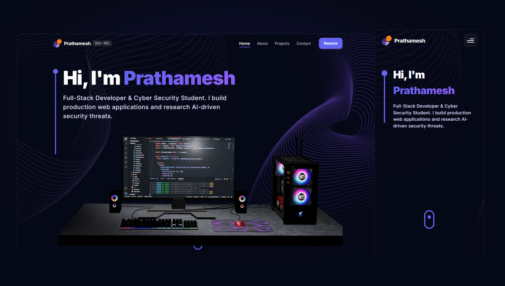

<div align="center">

<picture>
  <source media="(prefers-color-scheme: dark)" srcset="docs/assets/logo-mono-white.png" />
  <source media="(prefers-color-scheme: light)" srcset="docs/assets/logo-mono-black.png" />
  
</picture>

<p>
  Full-stack web developer and cybersecurity graduate (Class of 2026).<br />
  Building production web applications, secure cloud architectures, and researching AI-driven digital threats.
</p>

<p>
  <a href="https://prathameshchiddarwar.vercel.app/">Live Site</a> &bull;
  <a href="https://prathameshchiddarwar.vercel.app/about">About</a> &bull;
  <a href="https://prathameshchiddarwar.vercel.app/projects">Projects &amp; Research</a> &bull;
  <a href="https://prathameshchiddarwar.vercel.app/contact">Contact</a>
</p>

<p>
  
  
  
  
  = 18.0.0" />
  
  
</p>

</div>

---

<p align="center">
  
</p>

<details>
<summary><strong>Table of Contents</strong></summary>

- [About This Project](#about-this-project)
- [Core Features](#core-features)
- [Route Architecture](#route-architecture)
- [Tech Stack](#tech-stack)
- [Project Structure](#project-structure)
- [Getting Started](#getting-started)
- [Environment Variables](#environment-variables)
- [Available Scripts](#available-scripts)
- [Brand Assets & Screenshots Pipeline](#brand-assets--screenshots-pipeline)
- [Deployment Guide (Vercel)](#deployment-guide-vercel)
- [Performance & Quality](#performance--quality)
- [Roadmap](#roadmap)
- [License & Content Rights](#license--content-rights)
- [Contact](#contact)

</details>

---

## About This Project

I developed this portfolio to showcase my engineering background across two disciplines: production full-stack web development and applied cybersecurity research. Built with React 18, Vite, Three.js, and Tailwind CSS, the application serves as a responsive public profile and a real-world case study in clean frontend architecture, privacy-preserving asset delivery, and defensive client-side design.

The codebase prioritizes zero layout shift, strict type and asset boundaries, accessible landmark markup, and reproducible asset generation scripts without bloated third-party dependencies.

---

## Core Features

### Engineering Disciplines

| Area | Implemented Capabilities in Codebase |
| :--- | :--- |
| **Web Development** | &bull; Client-side Single Page Application (SPA) with React 18 and React Router v6.<br />&bull; 12-column responsive Bento Grid architecture across mobile, tablet, and desktop viewports.<br />&bull; Hardware-accelerated 3D graphics via Three.js, React Three Fiber, and Drei with automatic devicePixelRatio clamping and a unified single-canvas View pool (eliminating multi-context browser limits and context-loss crashes).<br />&bull; Single reusable `<Logo />` component enforcing minimum legible sizes, density srcset (1x/2x/3x), and light/dark theme swapping.<br />&bull; Session-scoped loader (`sessionStorage`) with `prefers-reduced-motion` detection and a hard 1.2s timeout. |
| **Cybersecurity & Hardening** | &bull; Client-side form sanitization and RFC-compliant email regex validation.<br />&bull; Honeypot spam trap (`honeypot_field`) with `tabIndex={-1}` and `aria-hidden` to intercept bot submissions without intrusive user challenges.<br />&bull; Strict `rel="noopener noreferrer"` and `target="_blank"` on every outbound link to prevent tab-nabbing and reverse-window manipulation.<br />&bull; Zero private secrets or privileged tokens stored in client bundles (EmailJS client public key only).<br />&bull; Privacy-hardened image pipeline stripping EXIF and GPS geolocation metadata from all photographic assets during optimization. |
| **Performance & Accessibility** | &bull; Modern image formats (`.webp`, `.avif`) with explicit `width` and `height` dimensions to eliminate Cumulative Layout Shift (CLS = 0).<br />&bull; Semantic HTML5 landmark tags (`<main>`, `<nav>`, `<footer>`, `<article>`, `<section>`, `<aside>`) with skip-to-content links.<br />&bull; Static Open Graph, Twitter Cards, and schema.org `Person` JSON-LD structured data.<br />&bull; Code-split vendor bundles via Rollup manual chunks separating React, Three.js, and Framer Motion. |

---

## Route Architecture

The portfolio implements 4 core user-facing views plus a dedicated error recovery route:

| Route | View Name | Primary Function |
| :--- | :--- | :--- |
| `/` | **Home** | Interactive 3D hero canvas, technical track overview, reverse-chronological experience timeline, interactive skill badges, and contact form. |
| `/about` | **About** | 12-column Bento Grid: Author bio, dual-track split, 4:5 responsive portrait with violet glow, career & research timeline, and education history. |
| `/projects` | **Projects** | Filterable project showcase (`All Work`, `Web Development`, `Cybersecurity`) with 2x featured IEEE Xplore publications and deep-dive modal case studies. |
| `/contact` | **Contact** | Secure direct communication portal featuring verified email clipboard action, location details, and EmailJS delivery. |
| `/404` | **404 Not Found** | Standalone error recovery view with centered brand mark and single-click home route navigation. |

*Note: Legacy routes (`/experience`, `/skills`, `/research`) automatically redirect to `/about` and `/projects` through React Router.*

---

## Tech Stack

<p align="left">
  
</p>

<details>
<summary><strong>Detailed Package Versions (from <code>package.json</code>)</strong></summary>

| Category | Technology | Version | Purpose in Project |
| :--- | :--- | :--- | :--- |
| **Frontend Core** | React | `^18.2.0` | UI component library |
| | ReactDOM | `^18.2.0` | Web DOM rendering |
| | React Router DOM | `^6.8.1` | Client-side declarative SPA routing |
| **3D & Canvas** | Three.js | `^0.149.0` | 3D WebGL rendering engine |
| | @react-three/fiber | `^8.11.1` | Declarative React Three.js reconciler |
| | @react-three/drei | `^9.56.24` | Three.js shader helpers and canvas controls |
| | Maath | `^0.5.2` | Math and buffer utilities for 3D stars canvas |
| **Animation & UX** | Framer Motion | `9.0.7` | UI transitions, bento entrance animations, and modal staging |
| | React Vertical Timeline Component | `^3.6.0` | Homepage experience and career progression timeline |
| | React Parallax Tilt | `^1.7.352` | Card tilt interactions |
| **Styling** | Tailwind CSS | `^3.2.6` | Utility-first CSS framework |
| | PostCSS / Autoprefixer | `^8.4.21` / `^10.4.13` | CSS preprocessing and vendor prefixing |
| **Form & Email** | @emailjs/browser | `^3.12.1` | Client-side email dispatching with direct mail client fallback |
| **Build & Tooling** | Vite | `^4.1.0` | Next-generation frontend build tooling and dev server |
| | Sharp | `^0.35.5` | High-performance reproducible asset processing |
| | Puppeteer Core | `^25.16.0` | Automated screenshot capture and validation harness |

</details>

---

## Project Structure

<details>
<summary><strong>Annotated Directory Tree</strong></summary>

```text
portfolio-website/
├── brand-source/               # Untouched original brand assets, raw logos & portraits
├── docs/                       # Documentation and README media
│   ├── assets/                 # Generated screenshots, banners, and theme-adaptive logos
│   └── BRAND.md                # Brand asset specifications, safe margins & palette
├── public/                     # Static root files served directly
│   ├── assets/                 # Verified resume PDF and document downloads
│   ├── favicon.ico             # Multi-resolution 16/32/48px transparent tab icon
│   ├── og-image.png            # 1200x630 social graph card
│   └── site.webmanifest        # PWA standalone manifest configuration
├── scripts/                    # Reproducible build and validation scripts
│   ├── build-brand-assets.mjs  # Sharp asset pipeline (WebP/PNG/favicons/portraits)
│   ├── capture-screenshots.mjs # Automated browser screenshot capture pipeline
│   └── ico-util.mjs            # Binary multi-size ICO generator
├── src/                        # Application source code
│   ├── assets/                 # SVGs, icons, and Vite-hashed generated brand files
│   ├── components/             # Reusable UI components, canvas scenes & layout blocks
│   │   ├── canvas/             # Computers, Earth, Stars, and Ball 3D WebGL canvases
│   │   └── shared/             # Logo, Navbar, Footer, and SVG icon components
│   ├── constants/              # Single source of truth for site data and projects
│   │   ├── data.js             # Detailed technical bio, skills & research paper metadata
│   │   └── index.js            # Homepage data, timeline cards, and navigation links
│   ├── hoc/                    # Higher-Order Components (SectionWrapper layout staging)
│   ├── pages/                  # Top-level route views (Home, About, Projects, Contact, 404)
│   ├── styles/                 # Custom Tailwind classes and typography definitions
│   ├── utils/                  # Framer Motion presets and EmailJS initialization
│   ├── App.jsx                 # Route table and legacy redirect declarations
│   └── main.jsx                # Application root mounting and DOM bootstrapping
├── .env.example                # Template for required environment variables
├── index.html                  # HTML5 entry with meta, Open Graph, Twitter & JSON-LD
├── package.json                # Project dependencies, scripts, and engine boundaries
├── tailwind.config.cjs         # Tailwind color palette and box-shadow extensions
└── vite.config.js              # Vite bundler, Rollup manual chunking & ES2020 target
```

</details>

---

## Getting Started

### Prerequisites

- **Node.js:** `>= 18.0.0` (Recommended: Node 20 LTS or Node 22)
- **npm:** `>= 9.0.0` (or `pnpm` / `yarn`)
- **Git:** Installed on local machine

### Installation & Run

1. **Clone the repository:**
   ```bash
   git clone https://github.com/prathamesh-07/portfolio-website.git
   cd portfolio-website
   ```

2. **Install dependencies:**
   ```bash
   npm install
   ```

3. **Configure environment variables:**
   ```bash
   cp .env.example .env
   ```
   *(Configure your EmailJS credentials in `.env` as described below)*

4. **Start the local development server:**
   ```bash
   npm run dev
   ```
   Open [http://localhost:5173](http://localhost:5173) in your browser.

5. **Build for production:**
   ```bash
   npm run build
   ```

6. **Preview the production bundle locally:**
   ```bash
   npm run preview
   ```

---

## Environment Variables

The application requires three public identifiers for the EmailJS contact integration. Store these in your local `.env` file (which is excluded from Git tracking via `.gitignore`):

| Variable Name | Purpose | Required | Example Placeholder |
| :--- | :--- | :--- | :--- |
| `VITE_APP_EMAILJS_SERVICE_ID` | EmailJS service connection ID | Yes | `service_xxxxxxx` |
| `VITE_APP_EMAILJS_TEMPLATE_ID` | EmailJS template layout ID | Yes | `template_xxxxxxx` |
| `VITE_APP_EMAILJS_PUBLIC_KEY` | EmailJS client-side public key | Yes | `xxxxxxxxxxxxxxxx` |

> [!NOTE]
> These three values are client-side identifiers required by the browser to route contact messages. They do **not** contain administrative secrets. For production hardening, configure domain origin restrictions in your EmailJS dashboard under **Account > Security > Allowed Domains**.

---

## Available Scripts

| Command | Action |
| :--- | :--- |
| `npm run dev` | Starts the Vite local development server with Hot Module Replacement (HMR). |
| `npm run build` | Compiles and optimizes assets into the `dist/` directory using Rollup chunk splitting. |
| `npm run preview` | Spins up a local static web server to test the production build in `dist/`. |
| `npm run brand` | Generates all derivative WebP/PNG logos, multi-size favicons, and portraits from `brand-source/`. |
| `npm run screenshots` | Automates headless browser capture of all pages and creates rounded, bordered README graphics. |

---

## Brand Assets & Screenshots Pipeline

All visual brand assets are generated deterministically from originals stored in `brand-source/`:

- **Logo System:** Monogram icon, transparent open-ring mark, horizontal lockup, stacked lockup, single-color white, and single-color black versions.
- **Portraits:** 4:5 editorial portrait, 1:1 square crop, and circular avatar derivatives exported at 480px, 800px, 1200px, and 1600px with AVIF, WebP, and JPG fallbacks (supported on both desktop sticky sidebar and mobile cards).
- **Zero Layout Shift:** Every asset is exported with known aspect ratios, explicit dimensions, and low-quality blur placeholders (LQIP).

Refer to [`docs/BRAND.md`](docs/BRAND.md) for complete palette codes, clear-space rules, and placement guidelines.

---

## Deployment Guide (Vercel)

The site is configured for production hosting on [Vercel](https://vercel.com):

1. **Import the repository** into your Vercel Dashboard.
2. **Framework Preset:** Select `Vite`.
3. **Build and Output Settings:**
   - **Build Command:** `npm run build`
   - **Output Directory:** `dist`
   - **Install Command:** `npm install`
4. **Environment Variables:**
   Under **Project Settings > Environment Variables**, add:
   - `VITE_APP_EMAILJS_SERVICE_ID`
   - `VITE_APP_EMAILJS_TEMPLATE_ID`
   - `VITE_APP_EMAILJS_PUBLIC_KEY`
5. **SPA Routing Configuration:**
   Client-side routing (`/about`, `/projects`, `/contact`) is handled seamlessly via [`vercel.json`](vercel.json):
   ```json
   {
     "framework": "vite",
     "rewrites": [
       { "source": "/(.*)", "destination": "/index.html" }
     ],
     "headers": [
       {
         "source": "/assets/(.*)",
         "headers": [
           { "key": "Cache-Control", "value": "public, max-age=31536000, immutable" }
         ]
       }
     ]
   }
   ```

---

## Performance & Quality

### Responsive Viewports

All pages, 3D canvases, and Bento tiles are verified across standard breakpoints:
- Mobile Small: `320px` – `375px`
- Mobile Medium: `390px` – `414px`
- Tablet: `768px` – `834px`
- Laptop: `1024px` – `1280px`
- Desktop: `1440px`+

### Lighthouse Audit Scores

<!-- TODO: Run local Lighthouse audit against production build (npm run preview) and update the table below with verified figures -->

| Platform | Performance | Accessibility | Best Practices | SEO | Audit Date & Tool |
| :--- | :---: | :---: | :---: | :---: | :--- |
| **Desktop** | *TODO* | *TODO* | *TODO* | *TODO* | Lighthouse CLI (Pending user measurement) |
| **Mobile** | *TODO* | *TODO* | *TODO* | *TODO* | Lighthouse CLI (Pending user measurement) |

---

## Roadmap

- [x] Dual-track architecture balancing Web Development and Cybersecurity.
- [x] 12-column responsive Bento Grid layout on `/about` and `/projects`.
- [x] Integration of 2x published IEEE Xplore research papers (ICTBIG 2024 & ICTBIG 2025) with verified DOIs.
- [x] Responsive 4:5 editorial portrait integration with AVIF/WebP multi-density srcset.
- [x] Contact form integration with client validation and hidden honeypot spam defense.
- [x] Deterministic Sharp brand generation pipeline (`npm run brand`).
- [ ] Add interactive live demonstration sandbox for deepfake audio spectral feature analysis.
- [ ] Implement dark/light theme toggle for the bento layout tiles.
- [ ] Configure custom domain with DNSSEC and automated SSL termination.

---

## License & Content Rights

- **Source Code:** Standard MIT License (subject to confirmation &mdash; see TODO list) <!-- TODO: Confirm license choice -->.
- **Personal Brand Assets & Written Content:** All photography, custom logos, visual design assets, research writing, and project descriptions are &copy; 2026 Prathamesh Chiddarwar. All rights reserved. Not for commercial reuse or redistribution without explicit written permission.

---

## Contact

- **Name:** Prathamesh Chiddarwar
- **Role:** Full-Stack Developer &amp; Cybersecurity Graduate (Class of 2026)
- **Email:** [prathameshchiddarwar42@gmail.com](mailto:prathameshchiddarwar42@gmail.com)
- **LinkedIn:** [linkedin.com/in/prathamesh-chiddarwar](https://linkedin.com/in/prathamesh-chiddarwar)
- **GitHub:** [github.com/prathamesh-07](https://github.com/prathamesh-07)
- **Location:** Pune, Maharashtra, India

<div align="center">
  <sub>Designed and built by Prathamesh Chiddarwar. Crafted with React, Three.js, and Tailwind CSS.</sub>
</div>
